# Home Assistant Companion on a Tuya T6E wall panel

How I turned a Tuya T6E 4-inch smart panel (Rockchip PX30, Android 8.1) into a Home Assistant wall panel, using ADB, a newer system WebView, and an older Companion release.

This is a record of one unit, including what failed. It isn't a universal guide: other production lots can behave differently.

> [!WARNING]
> You can make the panel unbootable by following this. The power base carries mains voltage. Work on your own device, keep verified backups, and read [Security warnings](#security-warnings) first: this setup leaves root access open to your LAN.

## Final result

| Item | Result on this unit |
| --- | --- |
| ADB over Wi-Fi | Works and survived reboots |
| WebView | Replaced 61.0.3163.98 with Cromite SystemWebView 132.0.6834.163 |
| Companion | `2025.11.4-minimal`; opened 8 times, rebooted once, and ran 2 minutes with no crash |
| Home screen | Companion starts automatically after boot |
| Touch response | Reported acceptable in everyday use |
| Scrolling | Poor: about 8 FPS while swiping. See [Performance](#step-10-measure-performance) |
| Tuya functions | Disabled, and not tested afterwards |

## Hardware

| Part | Detail |
| --- | --- |
| Panel | Tuya T6E "Smart Multi-functional Control Panel", Wi-Fi + Bluetooth + Zigbee |
| Mainboard | ST-PX30-T6E-V1.0 with Rockchip PX30 and Mali-G31 GPU |
| Display | 480×480 |
| Software | Android 8.1.0, `px30_evb`, `userdebug` build with test keys |
| Memory | About 954 MB RAM, 1.5 GB `/system` partition |
| Tools | Windows PC, Android platform-tools, micro-USB data cable |

## Contents

1. [Open the panel and find the ports](#step-1-open-the-panel-and-find-the-ports)
2. [Get ADB over USB](#step-2-get-adb-over-usb)
3. [Enable persistent ADB over Wi-Fi](#step-3-enable-persistent-adb-over-wi-fi)
4. [Install Companion](#step-4-install-companion)
5. [Understand why WebView 61 fails](#step-5-understand-why-webview-61-fails)
6. [Back up `/system` and verify it](#step-6-back-up-system-and-verify-it)
7. [Replace the system WebView](#step-7-replace-the-system-webview)
8. [Use a Companion version that doesn't crash](#step-8-use-a-companion-version-that-doesnt-crash)
9. [Make Companion the Home app](#step-9-make-companion-the-home-app)
10. [Measure performance](#step-10-measure-performance)

## Step 1: Open the panel and find the ports

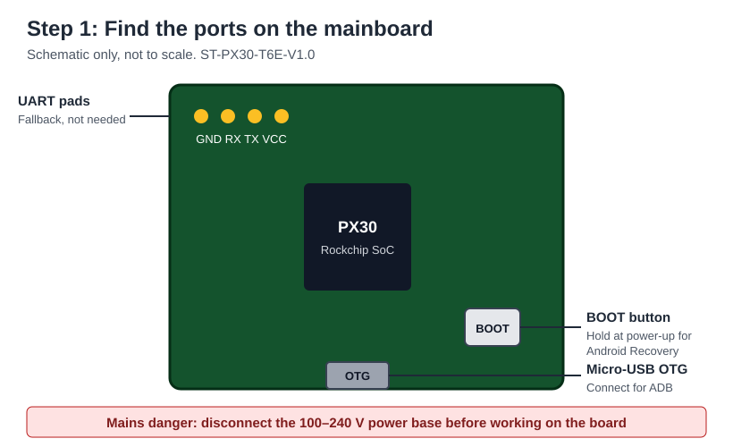

**Disconnect the panel from mains power before you open it.** The power base converts 100–240 V AC to 5 V, so keep it disconnected while you work on the board. Don't connect USB to the board while the base is live.

- **OTG:** the micro-USB port for ADB.
- **BOOT:** hold it during power-up to enter Android Recovery.
- **UART pads:** `GND`, `RX`, `TX`, `VCC`. They're a fallback that I didn't need to use.

In Recovery, never choose **Wipe data/factory reset**.

## Step 2: Get ADB over USB

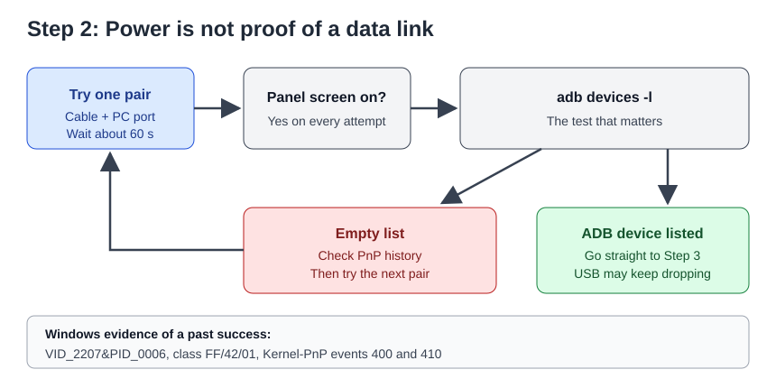

**Finding: USB can look dead when it isn't.** The panel powered up from PC USB in every attempt, yet ADB appeared with only some cable and port pairs. Power reaching the board doesn't prove the data lines work.

Before you give up on a cable or the board, check whether Windows has ever seen the device:

```powershell
Get-PnpDevice | Where-Object { $_.InstanceId -match 'VID_2207|VID_18D1|VID_0000' }
Get-WinEvent -FilterHashtable @{ LogName='Microsoft-Windows-Kernel-PnP/Configuration'; StartTime=(Get-Date).AddHours(-3) } |
  Where-Object { $_.Message -match 'VID_2207' } |
  Select-Object TimeCreated, Id, Message
```

On this unit, a device record `VID_2207&PID_0006` with class `FF/42/01` and Kernel-PnP events 400 and 410 showed that it had already enumerated as ADB earlier, even though later attempts showed nothing. That changed the job from "fix the driver" to "find the working cable and port pair".

Try each cable in each PC port, one at a time. Wait about 60 seconds after each plug-in, then run:

```powershell
adb devices -l
```

I didn't record which cable and port pair finally worked, so I can't tell you which kind to choose. Recovery and **Apply update from ADB** didn't enumerate on the pair I tried at the time. Windows bound its built-in ADB driver, so I didn't install one.

The USB link wasn't stable once connected. It kept re-enumerating, at first every few seconds during boot and later about every 20–25 seconds. Each disconnect made `init` restart `adbd`, which also dropped ADB over Wi-Fi. Moving the panel to a power-only supply stopped the disconnects during the checks that followed, so finish Step 3 and then stop using the PC for power.

## Step 3: Enable persistent ADB over Wi-Fi

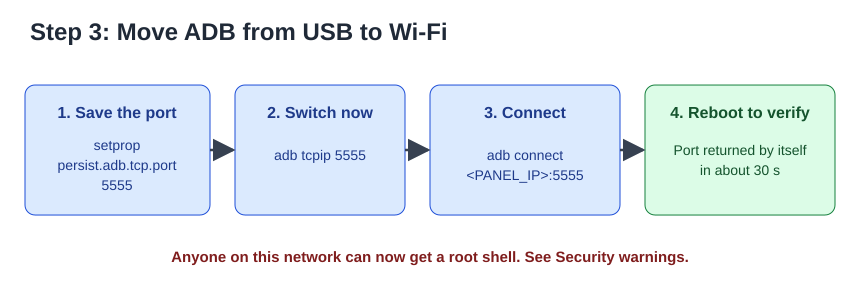

Put the panel on Wi-Fi and find its IP address in your router, then run:

```powershell
adb shell setprop persist.adb.tcp.port 5555
adb tcpip 5555
adb connect <PANEL_IP>:5555
adb -s <PANEL_IP>:5555 reboot
```

After the reboot, port 5555 returned by itself in about 30 seconds, without `adb tcpip` being run again. This firmware gave a normal `shell` prompt, not a `Tuya login:` prompt, and needed no authorization. Your lot may differ.

Reserve the panel's IP address in your router so it doesn't change.

## Step 4: Install Companion

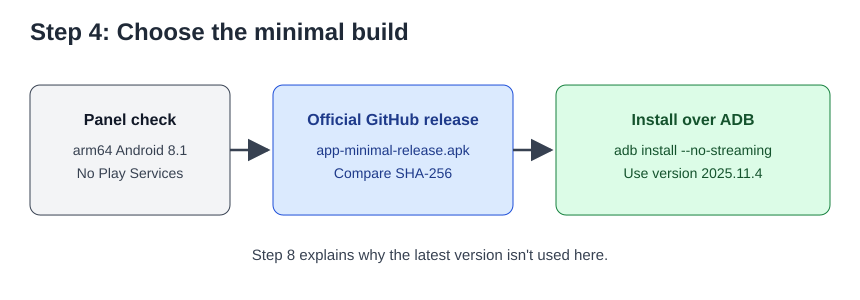

The panel has no Google Play Services, so use the `minimal` build from the [official releases](https://github.com/home-assistant/android/releases). Compare the SHA-256 with the digest on the release page, then install:

```powershell
Get-FileHash .\app-minimal-release.apk -Algorithm SHA256
adb -s <PANEL_IP>:5555 install --no-streaming .\app-minimal-release.apk
```

`--no-streaming` copies the file first. Installs can still fail if `adbd` restarts midway, so remove the data cable if you see that.

**Use version `2025.11.4`, not the latest.** [Step 8](#step-8-use-a-companion-version-that-doesnt-crash) explains why.

## Step 5: Understand why WebView 61 fails

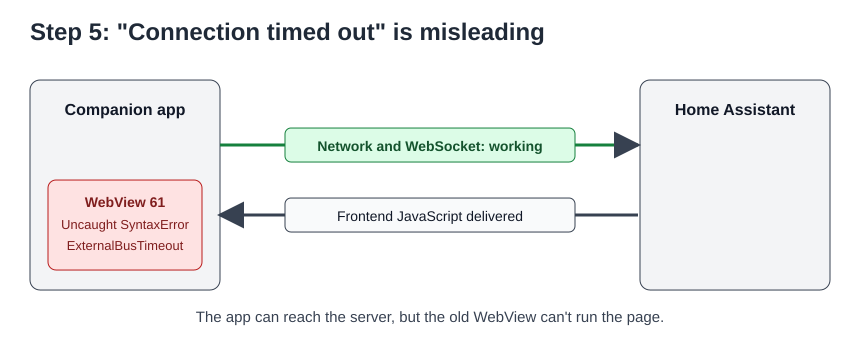

Companion showed "Unable to connect" and "Connection timed out", but the network was fine:

- The panel could reach Home Assistant over HTTP.
- The app's WebSocket exchanged messages with the server.
- The log showed `Frontend error: ExternalBusTimeout`.
- WebView reported `Uncaught SyntaxError: Invalid regular expression` while loading the frontend.

The system WebView was `61.0.3163.98`, which can't parse the current Home Assistant frontend. Changing URLs or Wi-Fi settings won't help.

## Step 6: Back up `/system` and verify it

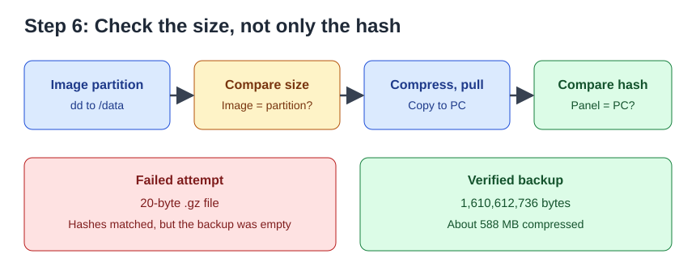

Take a full image before you change `/system`. [`scripts/image-system.sh`](scripts/image-system.sh) checks that the image size matches the partition:

```powershell
.\scripts\Invoke-PanelScript.ps1 -PanelIp <PANEL_IP> -ScriptPath .\scripts\image-system.sh
adb -s <PANEL_IP>:5555 pull /data/local/tmp/system.img.gz .
Get-FileHash .\system.img.gz -Algorithm SHA256
```

Compare the hash with the one the script prints, then delete the copy on the panel.

**A matching hash doesn't prove a good backup.** My first attempt produced a **20-byte `.gz` file**, and its hashes matched perfectly, because both sides were hashing the same empty archive. Always check the size. My good image was 1,610,612,736 bytes before compression and about 588 MB compressed.

Also save the original WebView folder to `/data` for a quick rollback:

```text
mkdir -p /data/local/tmp/webview-orig
cp -a /system/app/webview/. /data/local/tmp/webview-orig/
```

Run this as root, using `adb shell`, then `su`.

## Step 7: Replace the system WebView

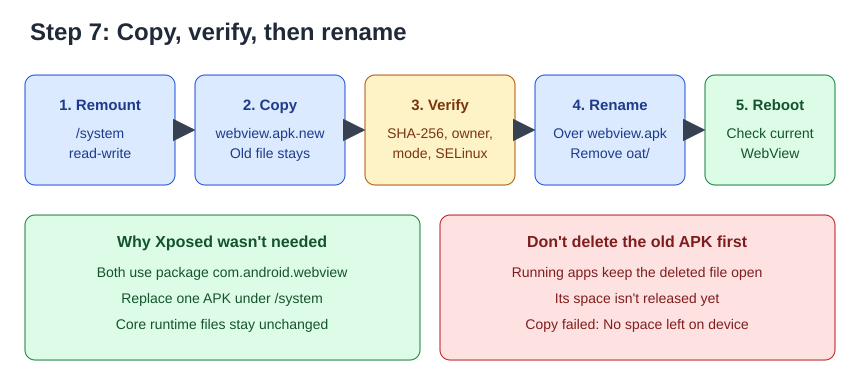

The [blakadder guide](https://blakadder.com/android-panel-webview/) uses Xposed and AnyWebView to choose a different WebView package. I didn't need that here. **Cromite's `SystemWebView` uses the same package name as the system WebView, `com.android.webview`.** That lets you replace one file rather than change core runtime files such as `libart`.

`adb install` can't do this, because it fails with `INSTALL_FAILED_UPDATE_INCOMPATIBLE` on the signature. Replacing the file under `/system` as root worked, and the log showed `System package com.android.webview signature changed; retaining data`.

This unit ended up with [Cromite 132.0.6834.163](https://github.com/uazo/cromite/releases/tag/v132.0.6834.163-ae296a42b9b1412a54aca8635affabd26ea8ce1e), file `arm64_SystemWebView.apk`. GitHub publishes no digest for that release, so I could only confirm that the panel's copy matched my download: SHA-256 `fef4e18615d11e3b33caccee698e00f33cf720b4c055a61abadc08e0ab22f60a`. The APK needs about 273 MB, so check that `/system` has enough free space.

```powershell
adb -s <PANEL_IP>:5555 push .\arm64_SystemWebView.apk /data/local/tmp/webview-new.apk
.\scripts\Invoke-PanelScript.ps1 -PanelIp <PANEL_IP> -ScriptPath .\scripts\swap-webview.sh -ScriptArgs <SHA256>
adb -s <PANEL_IP>:5555 reboot
adb -s <PANEL_IP>:5555 shell dumpsys webviewupdate
```

The last command should show the new version as the current package.

**Don't delete the old APK first.** I tried that when moving between Cromite versions, and the copy failed with `No space left on device`. Running apps still held the deleted file open, so its space wasn't released. To swap versions, reboot first if needed so the current file's space is accounted for, copy to `webview.apk.new`, then rename it over the old file.

`mount -o ro,remount /system` may report `Device or resource busy`. In my runs, `/system` came back read-only after the reboot.

## Step 8: Use a Companion version that doesn't crash

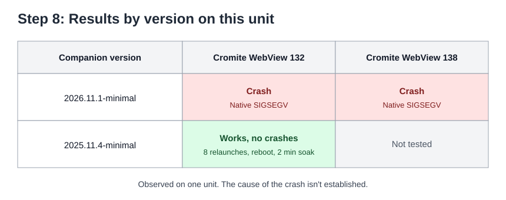

With WebView fixed, Companion `2026.11.1-minimal` crashed with a native `SIGSEGV` (fault address `0x18`) inside `webview.apk`, a few seconds after loading began. It crashed on both WebView 138 and WebView 132.

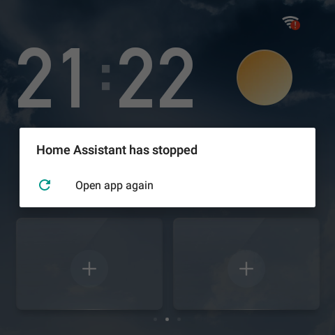

Other things I observed:

- The bundled WebView test app displayed the Home Assistant login page without crashing.
- The dashboard rendered once while a crash dialog held window focus, so that isn't a usable workaround.
- WebView feature flags didn't fix it: one flag looked promising in a single run, then crashed in 5 of 5 repeats.

[Companion `2025.11.4-minimal`](https://github.com/home-assistant/android/releases/tag/2025.11.4) (SHA-256 `2e81b675431fa6e40d6f778e28672e7fd126e747043b7b10dbba2a36c4795c80`) had no crashes on WebView 132 across 8 relaunches, a reboot, and a 2-minute soak.

**This was observed on this unit, and the cause isn't established.** I didn't test the Companion versions between these two, and I didn't test `2025.11.4` on WebView 138. Installing the older version required uninstalling the newer one, so the app had to log in again. Avoid updating Companion casually on this setup.

## Step 9: Make Companion the Home app

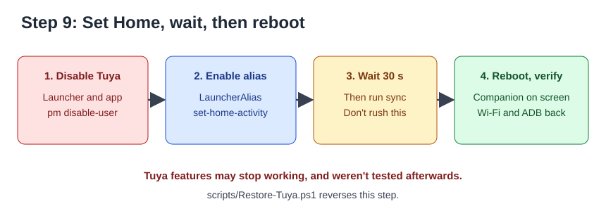

The Tuya app and its launcher take over the screen, including with a screensaver. Companion includes a Home alias that is off by default. [`scripts/Set-PanelHome.ps1`](scripts/Set-PanelHome.ps1) performs these commands as root:

```text
pm disable-user --user 0 com.tuya.iotgateway.launcher
pm disable-user --user 0 com.smartpad.fourinchneeu.smart
pm enable io.homeassistant.companion.android.minimal/io.homeassistant.companion.android.launch.LauncherAlias
cmd package set-home-activity io.homeassistant.companion.android.minimal/io.homeassistant.companion.android.launch.LauncherAlias
```

Before doing this, I confirmed that Android's own settings store the Wi-Fi network and the ADB port, so they don't depend on the Tuya app. After the reboot, Wi-Fi and ADB still worked, and Companion had focus within about 43 seconds.

**Wait about 30 seconds before you reboot.** When I rebooted immediately after disabling six factory apps, none stayed disabled. After waiting 30 seconds and running `sync`, they did. The likely reason is that Android hadn't yet written the change to disk, but I didn't confirm that.

**Tuya features may stop working.** That could include wall-switch functions and Zigbee through the panel. I didn't test them after this step. [`scripts/Restore-Tuya.ps1`](scripts/Restore-Tuya.ps1) reverses it.

`com.tuya.iotgateway.launcher` is a persistent system app, so its process stayed alive after being disabled, although it no longer took over the screen.

## Step 10: Measure performance

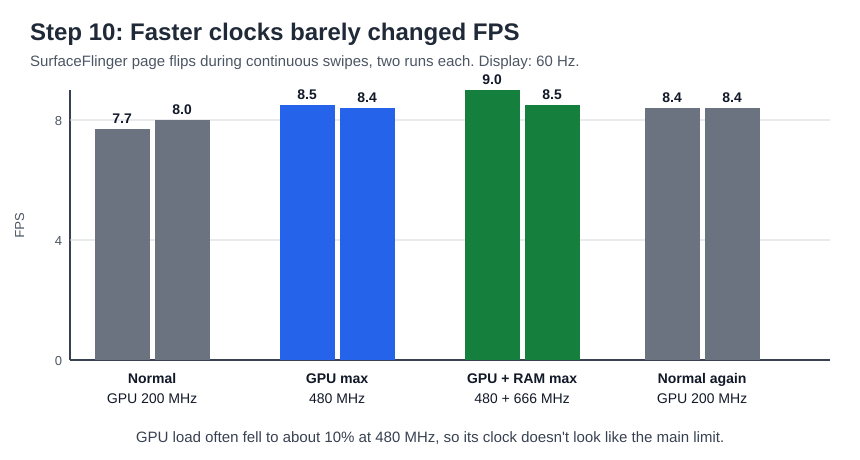

Scrolling stayed at **about 8 FPS** on a 60 Hz display, measured from SurfaceFlinger page flips during continuous swipes.

| Test | Method | Result |
| --- | --- | --- |
| Normal clocks | Page flips | 7.7–8.4 FPS |
| GPU locked to 480 MHz | Page flips | 8.4–8.5 FPS |
| GPU 480 MHz + RAM 666 MHz | Page flips | 8.5–9.0 FPS |
| Light entity-list dashboard vs. full dashboard | `gfxinfo` | 150 ms median on all, no gain under equal conditions |
| Standard theme vs. custom theme | `gfxinfo` | 150 ms median on both |
| WebView flags: vsync and frame limit off, GPU raster on or off, more raster threads, zero copy | `gfxinfo` | 150 ms median on all, no gain |
| Six factory and test apps disabled | Page flips | Before: 7.4–8.1 FPS. After: 7.0–8.1 FPS. No gain |

I didn't measure Tuya on and off under equal conditions. Disabling Tuya removed its boot-time CPU spike and freed memory, but scrolling afterwards stayed at the same 150 ms `gfxinfo` median seen before.

What this suggests, without proving it:

- At the normal 200 MHz, GPU load was about 47–69%. At 480 MHz, it often fell to about 10%, but FPS barely moved. **GPU clock doesn't appear to be the main limit.**
- There was no thermal throttling in these tests. The highest temperature I saw was 78°C.
- The display wasn't capped below 60 Hz, so "unlocking the frame rate" had no visible effect.
- I don't know the actual bottleneck. `gfxinfo` flagged slow draw commands on every frame, but its 150 ms median comes from coarse buckets and may not capture all WebView work.

One test once showed a 61 ms median, but I couldn't repeat it after reopening the app, so I don't count it.

## Troubleshooting

### PowerShell can run commands you didn't intend

**This rebooted my panel three times.** Windows PowerShell 5.1 strips inner double quotes when it passes arguments to native programs:

```powershell
# Dangerous in PowerShell 5.1
adb shell 'dmesg | grep -iE "error|reboot"'
```

The panel receives `grep -iE error|reboot`, so the shell pipes the output into the real `reboot` command. Errors such as `/system/bin/sh: something: not found` are the warning sign.

Don't put `|` patterns in inner double quotes. Push a script and run it instead, as [`scripts/Invoke-PanelScript.ps1`](scripts/Invoke-PanelScript.ps1) does.

### Other problems

| Symptom | What I found | What to do |
| --- | --- | --- |
| Panel powers up but `adb devices` is empty | Data path missing for that cable and port pair | Check device history as in Step 2, and try other pairs |
| ADB over Wi-Fi drops every 20–25 seconds | USB disconnects restart `adbd` | Use a power-only supply |
| `device offline`, or install fails midway | `adbd` restarted | Reconnect, then check whether the install actually finished |
| Companion shows `<unknown ssid>` | The app needs location permission to read the Wi-Fi name | Grant it and reopen the page, or set a fixed Home Assistant URL |
| "Connection timed out" with a working network | Old WebView can't run the frontend | Check the log for `ExternalBusTimeout`, then see Step 5 |
| Android "Open with" chooser covers the screen | The deep link matched two Companion activities | Press Back, then start `WebViewActivity` directly with its `path` extra |
| `No space left on device` during the swap | The deleted APK is still held open | Don't delete first; see Step 7 |

## Rollback

| To undo | Do this |
| --- | --- |
| Companion as Home, Tuya disabled | Run [`scripts/Restore-Tuya.ps1`](scripts/Restore-Tuya.ps1) |
| Replaced WebView | Run [`scripts/restore-webview.sh`](scripts/restore-webview.sh) as root, then reboot |
| ADB over Wi-Fi | `adb shell setprop persist.adb.tcp.port ""`, then reboot |
| Full `/system` | Your verified image is the last resort. I never tested restoring it |

I ran an earlier version of the WebView restore once, without problems. I wrote `Restore-Tuya.ps1` but haven't run it.

## Security warnings

This setup is only reasonable on a network you trust.

- **`ro.adb.secure=0`:** ADB requires no authorization on this firmware.
- **`su` needs no password:** a shell can become root immediately.
- **ADB over Wi-Fi gives root to your LAN:** anyone on that network can take over the panel.
- **The panel holds a Home Assistant login:** someone with root may be able to read its tokens and reach your Home Assistant.
- **The software is frozen:** Android 8.1, and an old WebView and Companion that no longer receive fixes. Use this WebView only for Home Assistant.

I recommend these precautions:

- Put the panel on an isolated network or VLAN, and allow only what it needs to reach Home Assistant.
- Use a dedicated, non-admin Home Assistant user for the panel.
- Disable ADB over Wi-Fi when you aren't using it.
- Don't publish `getprop` output or logs from the panel, which can contain device keys.
- Change any password or token you have pasted into a chat, script or log.

## Limitations and untested items

- Results come from one unit with one firmware version.
- Tuya features after disabling the apps, including wall switches and Zigbee through the panel.
- Companion versions between `2025.11.4` and `2026.11.1`, and `2025.11.4` on WebView 138.
- Long-term stability beyond the short tests described here.
- Companion notifications and sensors on this setup.
- The real supply voltage. The panel doesn't report it, so I can't rule out power effects.
- Restoring the full `/system` image, UART access, and Xposed or AnyWebView, none of which I needed.
- The cause of the Companion crash and of the low frame rate.

## Repository layout

| Path | Purpose |
| --- | --- |
| [`scripts/image-system.sh`](scripts/image-system.sh) | Create a size-checked `/system` image |
| [`scripts/swap-webview.sh`](scripts/swap-webview.sh) | Install a new WebView by verified rename |
| [`scripts/restore-webview.sh`](scripts/restore-webview.sh) | Restore the original WebView |
| [`scripts/Invoke-PanelScript.ps1`](scripts/Invoke-PanelScript.ps1) | Safely push and run a script as root |
| [`scripts/Set-PanelHome.ps1`](scripts/Set-PanelHome.ps1) | Make Companion Home and disable Tuya |
| [`scripts/Restore-Tuya.ps1`](scripts/Restore-Tuya.ps1) | Reverse `Set-PanelHome.ps1` |

**These scripts are cleaned-up versions of what I ran, with personal details removed and parameters added. They haven't been run in this exact form, so read them before you use them.**

Add `adb` to your `PATH` before running the PowerShell scripts. If your execution policy blocks them, use `powershell -ExecutionPolicy Bypass -File <script>`.

## Credits and references

- [blakadder: Sideloading on the T6E](https://blakadder.com/t6e-sideload/)
- [blakadder: Update WebView on NSPanel Pro and Tuya panels](https://blakadder.com/android-panel-webview/)
- [Home Assistant Companion for Android](https://github.com/home-assistant/android)
- [Cromite](https://github.com/uazo/cromite)
- [Home Assistant community: Install HA on Tuya 4" panel T6E](https://community.home-assistant.io/t/install-ha-on-tuya-4-panel-t6e-no-longer-possible/577662)
- [Home Assistant community: Tuya/Smatek T6E and S6E panels](https://community.home-assistant.io/t/tuya-smatek-t6e-and-s6e-4-inch-control-panels-for-ccs-central-control-system-android-based-in-wall-4-inch-smart-display-with-touch-screen-now-sold-under-many-different-brands/473366)

Not affiliated with Tuya, Smatek, Rockchip, Home Assistant or Cromite.

## License

[MIT](LICENSE). This covers the guide, scripts and images in this repository, not the third-party apps it refers to.
